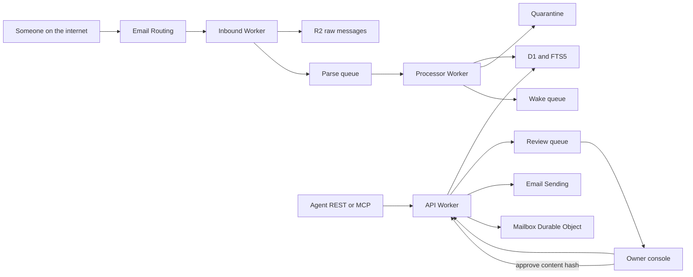

# cf-agent-mail

Self-hosted mailboxes for software agents, on your own Cloudflare account. An agent can read its mail and ask to send. Mail to anyone outside your account waits until you approve the exact text. You can turn sending off with one switch.

This is a published pattern. Nothing in the repo is tied to a particular account, zone, or domain. Examples use `example.com`.

## Architecture



Three Workers share this codebase:

- **Inbound** accepts Email Routing deliveries, writes the raw message to R2, then enqueues parsing. A message is rejected only for policy: unknown recipient, disabled mailbox, block list, or over 25 MiB.
- **Processor** parses with `postal-mime`, dedupes, threads, classifies, and writes the D1 full-text index. Suspicious mail is quarantined. A cron applies retention.
- **API** serves the agent REST API, the remote MCP server, and the owner console. Outbound mail uses the Email Sending binding. A Durable Object per mailbox holds send counters.

Agents authenticate with mailbox tokens. They never receive a Cloudflare API token.

## Features

- One address per agent, such as `surveys@mail.example.com`.
- Strict review by default. `known-auto` and `template-only` exist as configuration. `known-auto` still waits unless you set `ENFORCE_KNOWN_AUTO` to `true`. `template-only` refuses free text.
- Approval is bound to a hash of the recipients, subject, body, attachments, and thread. Editing the draft clears the approval.
- Template system mail (`otp`, `alert`, `digest`, `notify`) to allow-listed owner addresses skips review. Every other send returns `pending_review`.
- Inbound mail is untrusted. Prompt-injection patterns, hidden text, bidirectional overrides, mismatched links, phishing-shaped one-time codes, and risky attachments are quarantined. Agents cannot see quarantined mail until you release it.
- The Workers do not set `Message-ID` or `Date`. Email Sending assigns the message id. Threads keep `In-Reply-To` and `References`, plus a signed reply tag.
- Hashed API tokens, per-mailbox rate limits, a global kill switch, an audit log without message bodies, and retention settings.
- REST under `/v1` and a remote MCP server at `/mcp`. Tool names match AgentMail's mail tools.

`known-auto` is intentionally a stub. Leave it off until you have watched the review queue for a while.

## Cost

Email Sending to arbitrary recipients requires the Workers Paid plan. Pricing below is from the [Email Service pricing page](https://developers.cloudflare.com/email-service/platform/pricing/) as published on 9 June 2026 and checked on 27 October 2026. Confirm the live page before you rely on it.

- 3,000 included sends per Cloudflare account per month, then $0.35 per additional 1,000.
- Sends to verified destination addresses are free and do not count toward the quota.
- Email Routing is unlimited on the Free and Paid plans.
- Email Workers are billed as Workers requests and CPU.
- R2 storage is about $0.015 per GB-month, plus the usual operation charges.

A mailbox that sends a few hundred reviewed messages a month should add roughly $0–$3 beyond Workers Paid, plus stored raw mail. Email Sending is a transactional product in public beta. It is not a bulk mail service.

## Limits

- Email Routing allows 200 literal rules per domain. There is no catch-all for a subdomain. Each agent address is one rule, generated from `mailbox_slugs`. Adding an address means updating that list and redeploying the inbound Worker.
- Inbound messages are limited to 25 MiB. Outbound messages are limited to about 5 MiB. This project caps an agent draft at 5 recipients and 32 attachments. The subject is capped at 998 characters.
- Plus-addressing has to be enabled on the zone so signed reply tags (`slug+t.<thread>.<tag>@your-domain`) reach the base rule.
- New Email Sending accounts can have a lower daily quota than the published steady-state limit.
- PDF and office attachments are stored. Text extraction covers plain text and JSON only.
- A daily reconcile of Email Routing analytics against stored mail needs a Cloudflare API token and is not part of this Worker. The Worker does not hold that token.

## Do not point this at a zone that already receives mail

Enabling Email Routing on a zone publishes MX records at **that zone's apex**. Cloudflare's routing setup replaces whatever MX was there. If `example.com` already receives mail, onboarding Email Routing on `example.com` can take that mail away, including the apex, not only `mail.example.com`.

Use a zone whose only job is this mail. The usual pattern is to delegate `mail.example.com` as its own Cloudflare zone, set `zone_name` to `mail.example.com`, and set `mail_subdomain` to `@`. The parent zone's MX stays untouched.

The root `wrangler.jsonc` is for local tests. It contains development placeholders and `EMAIL_MODE=record`, which journals mail instead of sending it. Deploy `workers/inbound`, `workers/processor`, and `workers/api` after `bootstrap/onboard.sh` fills in your account. Do not deploy the root file.

## Start here

- [docs/SELF-HOSTING.md](docs/SELF-HOSTING.md) is the setup guide.
- [docs/EXPLAINER.md](docs/EXPLAINER.md) is the short version for the person who approves mail.
- [bootstrap/GROK-BOT.md](bootstrap/GROK-BOT.md) and [bootstrap/OPENAI-CODEX.md](bootstrap/OPENAI-CODEX.md) are prompts for an agent that sets up its own instance with you.
- [SECURITY.md](SECURITY.md) describes the trust boundaries.

```bash
cp cf-agent-mail.config.example.json cf-agent-mail.config.json
# edit the copy, then:
./bootstrap/onboard.sh --config cf-agent-mail.config.json
```

The first run is a dry run. It prints the plan and does not create resources or send mail. `--apply` is the step that talks to Cloudflare.

## License

MIT. See [LICENSE](LICENSE).
